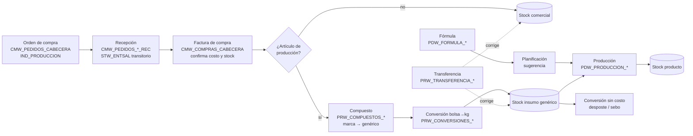
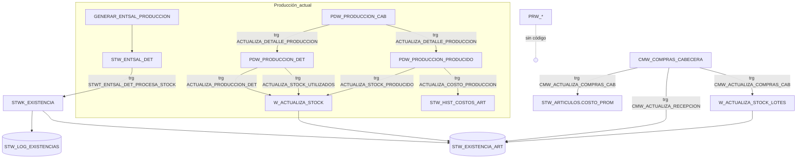

# Módulo de Producción — Fase 1: diagnóstico

Fecha: 2026-10-09 · Aplicación 100 (GRUTTER ARM) · Esquema `INV` · Base `GRUTTERPDB`

Fase de solo lectura: no se modificó la base ni la aplicación. Toda afirmación
sobre objetos sale del diccionario de datos o del fuente APEXlang exportado
(`src/apex/app100/`). Lo que no pudo comprobarse figura como **pendiente**.

---

## 0. Fuentes analizadas y faltantes

| Fuente | Estado |
|---|---|
| Diccionario de datos (`ALL_*`) del esquema `INV` | Analizado |
| Código de triggers y procedimientos visibles para `CLAUDE_INV` | Analizado |
| Fuente APEX de la aplicación 100 (989 páginas) | Analizado (§7), incluidas tus páginas 512/513 y 741 |
| Datos reales de producción, compras y stock | Muestreados en modo lectura |
| **A. Mini relevamiento (9.1–9.7)** | **No recibido.** Se usó la descripción del prompt |
| **B. Transcripción de la reunión** | **No recibida.** Se usó la descripción del prompt |
| **C. DDL** | Se tomó el instalado en la base, no el del documento |
| Código de `STWK_EXISTENCIA`, `STWK_COSTOS`, `STW_PKG`, `TRAE_MULT_UB`, `TRAE_COSTO_PROM`, `TRAE_ID_LISTA_PRECIO` | **No legible**: `CLAUDE_INV` no tiene privilegio sobre ellos (se ven solo los sinónimos públicos) |

---

## 1. Resumen ejecutivo

1. **Las tablas `PRW_*` se crearon hoy (2026-10-09), están vacías y ningún
   código las usa.** No hay tablas `PR_CONVERSION_*`: la variante `PR_` no está
   instalada. La tabla de resultados se llama `PRW_CONVERSION_RES`, no
   `PRW_CONVERSIONES_RES` como dice el material.
2. **Las `PRW_*` no siguen el modelo del resto del esquema.** No tienen claves
   foráneas, ni únicas, ni secuencias, ni triggers de ID; mezclan `ID_ARTICULO`
   numérico con `COD_ARTICULO VARCHAR2(30)`, `ID_EMPRESA NUMBER` con
   `ID_EMPRESA VARCHAR2(5)` (y `NUMBER(5)` en el detalle de transferencia),
   `COD_SUCURSAL` y `COD_UNIDAD_MEDIDA` alfanuméricos. Parecen portadas de un
   modelo anterior basado en códigos. **Hay que corregir su DDL antes de
   construir encima** (§5.1).
3. **La producción actual (`PDW_PRODUCCION_*`) mueve stock y costo por triggers,
   con defectos graves comprobados:**
   - **Doble descuento de insumos.** Dos triggers sobre `PDW_PRODUCCION_DET`
     (`ACTUALIZA_PRODUCCION_DET` y `ACTUALIZA_STOCK_UTILIZADOS`) descuentan stock
     al confirmar: uno `cantidad × cant_producir`, el otro `cantidad`.
   - **El producido mueve stock por dos caminos.** El trigger
     `ACTUALIZA_STOCK_PRODUCIDO` suma con `W_ACTUALIZA_STOCK` y
     `GENERAR_ENTSAL_PRODUCCION` genera además un ajuste `STW_ENTSAL` que pasa
     por el mecanismo oficial. En la producción 628 (la única confirmada) el
     artículo 19726 recibió **+15** por trigger y **dos salidas de 10** en el log
     oficial.
   - **Ajustes generados para producciones no confirmadas** (606, 608, 609).
   - **`ACTUALIZA_COSTO_PRODUCCION` borra todo el historial de costos del
     artículo** (`delete stw_hist_costos_art where id_empresa = … and
     id_articulo = …`, sin filtro de documento) cada vez que se modifica o borra
     una línea producida.
   - **El costo promedio no se pondera en producción:** el cálculo ponderado está
     comentado y se graba `costo_prom_nuevo = costo` del documento.
   - **`GENERAR_ENTSAL_PRODUCCION` hace `COMMIT` dentro del bucle**, y tiene fijos
     la moneda (32), los centros de costo (`'584'`, `'1822'`) y la numeración por
     `MAX+1`.
4. **Hay dos mecanismos de stock conviviendo:**
   - **Oficial:** `STWK_EXISTENCIA.ACTUALIZA_EXISTENCIA`, invocado desde
     `STW_ENTSAL_DET` y ventas; registra cada movimiento en `STW_LOG_EXISTENCIAS`
     (688 mil filas) y admite reversión.
   - **Legado:** `W_ACTUALIZA_STOCK`, que hace `UPDATE` directo a
     `STW_EXISTENCIA_ART` **sin log**. Lo usan producción y otros triggers.
   **Todo lo nuevo debe ir por el oficial.**
5. **Costo de compras y riesgo bolsa/kilo.** El costo promedio se recalcula al
   confirmar la factura de compra (trigger `CMW_ACTUALIZA_COMPRAS_CAB`) con
   promedio ponderado. El divisor suma `existencia` (en unidad base, de
   `STW_EXISTENCIA_ART`) + `DET.CANTIDAD` (en unidad de compra). **Si la compra
   viene en bolsas y el stock está en kilos, el costo promedio queda mal.** Es
   exactamente el síntoma descrito por producción. A verificar con un caso real
   (§9, P-03).
6. **`CMW_PEDIDOS_CABECERA.IND_PRODUCCION` existe pero ningún código lo usa**
   (solo un trigger de auditoría). 4 de 581 órdenes lo tienen en `S`.
   `STW_ARTICULOS.IND_PRODUCCION` e `IND_INSUMO` también existen y están
   prácticamente sin cargar (26 artículos en `N`, el resto nulo).

---

## 2. Diagnóstico funcional

### 2.1 Requisitos confirmados por el relevamiento (según el prompt)

- Producción por demanda del día, con fórmulas/guías.
- Tipos: panadería, confitería, conversión de fraccionado, verdulería,
  fiambrería y mermas.
- Registro de lo producido en la jornada y confirmación.
- Presentaciones (granel / paquete) con rendimiento por unidad y por kilo.
- Comparación de rendimiento teórico y real (variación aprox. ±5).
- Artículos compuestos: varias marcas como un insumo genérico.
- Planificación con referencia histórica.

### 2.2 Reglas que se deducen de la reunión (según el prompt)

- La recepción de mercadería marcada para producción debe terminar como insumo
  genérico, no como artículo comercial.
- La conversión bolsa→kilo debe mover cantidad **y** costo.
- Conversión **con** costo (el valor de los insumos pasa a los resultados) y
  **sin** costo (reclasificación: desposte, sebo) son políticas distintas.
- Las transferencias se usan hoy para corregir recepciones mal registradas.

### 2.3 Supuestos no confirmados

| # | Supuesto | Por qué importa |
|---|---|---|
| S-1 | El stock de `STW_EXISTENCIA_ART.CANT_DISPON` está en unidad base | Toda normalización depende de esto. El código oficial mueve `cantidad_ub` |
| S-2 | `PDW_FORMULA_DET.CANTIDAD` es por unidad de producto, no por la cantidad de referencia de la cabecera | El trigger multiplica `cantidad × cant_producir`; la cabecera tiene `CANTIDAD`/`CANTIDAD_UB` de referencia |
| S-3 | `PRW_COMPUESTOS_CABECERA.ID_PRODUCTO` es el genérico y `PRW_COMPUESTOS_DETALLE.ID_PRODUCTO` cada marca, unidos por `ID_COMPUESTO` | Sin FK ni UK no se puede afirmar |
| S-4 | El ±5 del relevamiento es una tolerancia en unidades | Podría ser porcentaje o depender de la presentación |

### 2.4 Decisiones que necesitan al área usuaria / contable

| # | Decisión | Alternativas |
|---|---|---|
| D-1 | Orden de compra **sin** `IND_PRODUCCION` que trae un artículo de producción | (a) bloquear la confirmación; (b) advertir y dejar registro; (c) convertir igual. Recomendado: **(a) bloquear**, con permiso de excepción auditado |
| D-2 | Costo del subproducto en conversión sin costo (sebo) | (a) valor de mercado/NRV fijado por contabilidad; (b) costo estándar configurado; (c) costo cero explícito y aprobado. Recomendado: **(b)**, descontándolo del costo del principal para no crear ni destruir valor |
| D-3 | Tolerancia de rendimiento | Global / por fórmula / por presentación; advertir o bloquear. Recomendado: **por fórmula, en %, con advertencia y bloqueo sobre un segundo umbral** |
| D-4 | Corrección de recepción por transferencia: ¿costo de origen o promedio actual? | Recomendado: **costo del documento de origen** cuando hay trazabilidad |
| D-5 | Ventana histórica para la planificación | Sin dato no se implementa: se ofrece la sugerencia con parámetros explícitos |
| D-6 | ¿Se corrigen las producciones ya confirmadas (628) y sus movimientos? | Requiere conciliación de stock antes de tocar nada |

---

## 3. Inventario de objetos

### 3.1 Tablas del módulo

| Tabla | Filas | Creada | PK | FK / UK | Rol |
|---|---|---|---|---|---|
| `PDW_FORMULA_CAB` | 553 | 2026-08 | `ID` | FK artículo, UM, sucursal destino. **Sin UK** sobre `(ID_EMPRESA, COD_FORMULA)` | Cabecera de fórmula. `ID_EMPRESA VARCHAR2(5)` (las demás `NUMBER`) |
| `PDW_FORMULA_DET` | 3.904 | 2026-08 | `ID` | FK artículo, UM. **Sin FK a la cabecera** | Ingredientes: `CANTIDAD`, `CANTIDAD_UB`, merma, `PARTICIPACION`, `IND_AFECTA_*` |
| `PDW_FORMULA_PRODUCIDOS` | 1.288 | 2026-08 | `ID` | FK artículo, UM. **Sin FK a la cabecera** | Resultados: `TIPO_COSTEO`, `COSTO_FIJO`, `PORCENTAJE`, `ARTICULO_PRINCIPAL` |
| `PDW_PRODUCCION_CAB` | 5 | 2026-08 | `ID` | **Ninguna** | Orden de producción. Tipos mezclados (`ID_FORMULA VARCHAR2(5)`, `ID_ARTICULO VARCHAR2(20)`) |
| `PDW_PRODUCCION_DET` | 44 | 2026-08 | `ID` | FK artículo, UM, lote. Sin FK a la cabecera | Insumos consumidos |
| `PDW_PRODUCCION_PRODUCIDO` | 5 | 2026-08 | `ID` | FK artículo, UM, lote | Producido: `COSTO`, `CANT_PRODUCIR`, `CANT_PROCESADA`, `CANT_DIFERENCIA` |
| `PDW_HIST_FORMULA_*` | 0 | | | | Histórico de fórmulas (sin uso) |
| `PRW_COMPUESTOS_CABECERA` | 0 | **hoy** | `ID` | **Ninguna** | `ID_COMPUESTO`, `ID_PRODUCTO`, `COSTO_GUIA_PROD` |
| `PRW_COMPUESTOS_DETALLE` | 0 | **hoy** | `ID` | **Ninguna** | `ID_COMPUESTO`, `ID_PRODUCTO` |
| `PRW_COMPUESTOS_SUCURSALES` | 0 | **hoy** | `ID` | **Ninguna** | `ID_COMPUESTO`, `ID_SUCURSAL`. Auditoría inconsistente (`ID_USU_ALTA NUMBER` vs `COD_USU_MODIF`) |
| `PRW_CONVERSIONES_CAB` | 0 | **hoy** | `ID` | **Ninguna** | Comprobante (`TIP/SER/NRO`), `ESTADO`, `IND_DESPOSTE`, gastos, confirmación/anulación |
| `PRW_CONVERSIONES_ING` | 0 | **hoy** | `ID` | **Ninguna** | Insumos. Se une a la cabecera por `TIP/SER/NRO`, no por ID. `NRO_LOTE` texto, `COD_UNIDAD_MEDIDA` texto |
| `PRW_CONVERSION_RES` | 0 | **hoy** | `ID` | **Ninguna** | Resultados. **`COD_ARTICULO VARCHAR2(30)`** (no ID) |
| `PRW_TRANSFERENCIA_CAB` | 0 | **hoy** | `ID` | **Ninguna** | `ID_EMPRESA VARCHAR2(5)`, `COD_SUCURSAL`/`COD_SUCURSAL_ENT` texto |
| `PRW_TRANSFERENCIA_DET` | 0 | **hoy** | **Sin PK** | **Ninguna** | `ID_EMPRESA NUMBER(5)`, `COD_ARTICULO`, `ID_ARTICULO_CONV VARCHAR2(30)` |

### 3.2 Compras, recepción, stock y costo

| Objeto | Rol comprobado |
|---|---|
| `CMW_PEDIDOS_CABECERA` / `_DETALLE` | Orden de compra (el nombre real es `CABECERA`, no `CAB`). `IND_PRODUCCION` sin uso en código |
| `CMW_PEDIDOS_CABECERA_REC` / `_DETALLE_REC` | Recepción contra la orden. El trigger `…_REC_CONFIRMACION` acumula `cantidad_confirmada` en el pedido |
| `STW_ENTSAL_CAB` / `_DET` | Entradas/salidas de stock: recepción a depósito transitorio, ajustes y producción |
| `CMW_COMPRAS_CABECERA` / `_DETALLE` | Factura de compra. Al confirmar, `CMW_ACTUALIZA_COMPRAS_CAB` recalcula el costo y mueve stock (`W_ACTUALIZA_STOCK_LOTES`), y `CMW_ACTUALIZA_RECEPCION` retira la recepción del transitorio con `UPDATE` directo |
| `STW_EXISTENCIA_ART` | Existencia por empresa, sucursal, artículo y lote (2,1 M filas) |
| `STW_LOG_EXISTENCIAS` | Log del mecanismo oficial |
| `STW_HIST_COSTOS_ART` | Historial de costos: **solo 50 filas** |
| `STW_ARTICULOS` | `COSTO_PROM`, `COSTO_ULTIMO`, `*_ANTERIOR`, `ID_UNIDAD_MEDIDA`, `ID_RELACION_UM`, `IND_PRODUCCION`, `IND_INSUMO`, `IND_MANEJA_STOCK`, `IND_MANEJA_LOTE` |
| `STW_RELACIONES_CAB` / `STW_RELACIONES` | Relaciones de unidades (BOLSA, CAJA, PAQUETES…) con `MULT`/`DIVISOR`. **`STW_RELACIONES.ID_RELACION_UM` no resuelve contra `STW_RELACIONES_CAB.ID`, ni `ID_UNIDAD_REL` contra `STW_UNIDADES_MEDIDA.ID`**: la semántica real está en `STW_PKG.TRAE_MULT_UB` (no legible) |

### 3.3 Código relevante

| Objeto | Tipo | Hace | Observación |
|---|---|---|---|
| `STWK_EXISTENCIA.ACTUALIZA_EXISTENCIA` | Paquete | Mueve stock con log y reversión | **Oficial**. Código no legible |
| `STW_PKG.TRAE_MULT_UB` | Paquete | Convierte una cantidad a la unidad base | Equivalencia oficial bolsa→kg |
| `STWK_COSTOS` | Paquete | Pendiente de leer | Probable servicio de costos |
| `W_ACTUALIZA_STOCK` | Procedimiento | `UPDATE` directo a la existencia | Legado, sin log |
| `W_ACTUALIZA_STOCK_LOTES` | Procedimiento | Stock con lote y costo | Usado por compras |
| `GENERAR_ENTSAL_PRODUCCION` | Procedimiento | Genera el ajuste `AJS` del producido | `COMMIT` en bucle, valores fijos |
| `TRAE_COSTO_PROM` | Función | Costo promedio a una fecha | No legible |
| Triggers `PDW_PRODUCCION_*` | Triggers | Stock y costo de producción | Ver §1, punto 3 |
| `CMW_ACTUALIZA_COMPRAS_CAB` | Trigger | Costo promedio ponderado al confirmar la compra | Ver §1, punto 5 |
| `CONFIRMACION_ENT_SAL` | Trigger | Costo y stock al confirmar entradas/salidas | Fórmula ponderada propia (`(prom × exist + costo) / (exist + cant)`) |

**No existe ningún paquete de producción.** Los paquetes de negocio visibles son
`PACK_CONFIRM_COSTOS_CMW`, `PKGBS`, `PKGCC`, `PKGFE` y `PKGST`.

---

## 4. Mecanismos de stock y costo

```
                       ┌───────────────────────────┐
  STW_ENTSAL_DET ─────►│ STWK_EXISTENCIA           │──► STW_EXISTENCIA_ART
  VTW (ventas)  ─────►│ .ACTUALIZA_EXISTENCIA     │──► STW_LOG_EXISTENCIAS
                       └───────────────────────────┘    (log + reversión)

  PDW_PRODUCCION_* ──► W_ACTUALIZA_STOCK ──────────────► STW_EXISTENCIA_ART  (sin log)
  CMW_COMPRAS_CAB  ──► W_ACTUALIZA_STOCK_LOTES ────────► STW_EXISTENCIA_ART
  CMW_ACTUALIZA_RECEPCION ── UPDATE directo ───────────► STW_EXISTENCIA_ART
```

**Costo promedio:** hay al menos tres implementaciones distintas.

| Dónde | Fórmula |
|---|---|
| Compra (`CMW_ACTUALIZA_COMPRAS_CAB`) | `(costo_prom_ant × existencia + costo_total) / (existencia + cantidad_compra)` |
| Entradas/salidas (`CONFIRMACION_ENT_SAL`) | `(costo_prom × existencia + costo) / (existencia + cantidad)` |
| Producción (`ACTUALIZA_COSTO_PRODUCCION`) | No pondera: graba el costo del documento |

La regla 16 del prompt ("no hacer que una pantalla use una fórmula y otra otra")
**ya se incumple hoy.** El módulo nuevo debe usar un único servicio de valoración
y no sumar una cuarta fórmula.

---

## 5. Hallazgos que bloquean el desarrollo

### 5.1 DDL de las `PRW_*`

Antes de escribir código sobre ellas:

- Unificar tipos con el resto del esquema: `ID_EMPRESA NUMBER(10)`,
  `ID_SUCURSAL`, `ID_ARTICULO`, `ID_UNIDAD_MEDIDA` e `ID_LOTE` numéricos con FK a
  `BSW_EMPRESAS`, `BSW_SUCURSALES`, `STW_ARTICULOS`, `STW_UNIDADES_MEDIDA` y
  `STW_LOTES`.
- Detalle → cabecera por `ID_<cab>` con FK, no por `TIP/SER/NRO`.
- UK de negocio: comprobante `(ID_EMPRESA, TIP, SER, NRO)`; compuesto genérico
  `(ID_EMPRESA, ID_PRODUCTO)`; marca `(ID_EMPRESA, ID_PRODUCTO)` en detalle, para
  que una marca pertenezca a **un solo** genérico (§5.2 del prompt); sucursal
  `(ID_COMPUESTO, ID_SUCURSAL)`.
- PK en `PRW_TRANSFERENCIA_DET`.
- Secuencias e `ID` por defecto, siguiendo el patrón `…_ID_SEQ` del esquema.
- `CHECK` de estados (`P` pendiente, `C` confirmado, `A` anulado; a validar con
  el uso actual de `PDW_PRODUCCION_CAB.ESTADO`/`ANULADO`).
- Columnas de referencia a la recepción de origen en conversión y transferencia
  (trazabilidad, D-4).

Como las tablas están vacías y se crearon hoy, **corregirlas ahora no tiene costo
de migración**. Más adelante sí lo tendría.

### 5.2 Producción actual

No se puede construir la confirmación nueva encima de los triggers actuales: hay
que **reemplazarlos por un procedimiento de confirmación** (§8) y desactivarlos
en el mismo despliegue. Antes hay que conciliar la producción 628 y las
entradas/salidas 10, 11, 12, 13 y 24.

---

## 6. Mapa de dependencias

### 6.1 Proceso



### 6.2 Técnico (estado actual)



---

## 7. Páginas APEX

**No hay ninguna página para compuestos, conversiones ni transferencias entre
artículos**: ninguna página ni LOV usa `PRW_*`. (Las páginas 423 y 865,
"combos compuestos", son combos de punto de venta sobre `PVW_COMBOS_*`, no
producción.)

### 7.1 Páginas existentes del módulo

| Pág | Qué es | Tablas |
|---|---|---|
| 512 | Lista de fórmulas (informe interactivo) | `PDW_FORMULA_CAB` |
| 513 | **Carga de fórmula** (modal): cabecera + grilla "A Producir" + grilla "Alimentación" | `PDW_FORMULA_*` |
| 515 | Lista de órdenes de producción (grilla **editable**) | `PDW_PRODUCCION_CAB` |
| 741 | **Carga de orden de producción** multi-fórmula | `PDW_PRODUCCION_*` |
| 516 | Versión anterior de la 741, sin enlaces entrantes | `PDW_PRODUCCION_*` |
| 768 | "Generar Ent/Sal Producción": llama a `GENERAR_ENTSAL_PRODUCCION` | `STW_ENTSAL_*` |
| 780 | Referencia de ajustes de una producción | `STW_ENTSAL_*` |
| 762, 695, 760, 761, 763, 770 | Informes e impresión (Jasper) | |
| 7 / 892 | Orden de compra / autorización. `P7_IND_PRODUCCION` se guarda y **nada lo usa** | `CMW_PEDIDOS_*` |
| 894, 896, 897 | Recepción de pedidos. La 894 **no copia `IND_PRODUCCION`** del pedido a la recepción | `CMW_PEDIDOS_*_REC` |
| 130 | Ficha de artículo: checkbox `IND_PRODUCCION` | `STW_ARTICULOS` |

### 7.2 Cómo se confirma hoy una producción

En la 741 la columna "PRODUCIR" de cada producido abre la **768**. Esa página
corre `GENERAR_ENTSAL_PRODUCCION` al cargar, sin esquema de autorización, y
**no depende del estado de la orden**. Por eso hay ajustes de stock generados
para órdenes pendientes. Ninguna página pasa `ESTADO` a `C` de forma
controlada: la grilla editable de la 515 permite cambiarlo directamente, y ese
cambio dispara los triggers de stock y costo (§1, punto 3).

### 7.3 Defectos de las páginas que tu desarrollo ya tiene (512/513 y 741)

**513 — fórmulas**
- No hay validaciones de servidor.
- Nada impide modificar o borrar una fórmula ya usada en producciones: el
  proceso `ELIMINAR_DETALLES` borra sin verificar.
- La sucursal del ingrediente tiene un valor por defecto fijo (`1`).
- `COD_FORMULA` se calcula con `max(to_number(cod))+1`: hay riesgo de
  concurrencia y falla si existe un código no numérico. Además, la tabla no
  tiene UK.
- La acción `validate_um` llama a `TRAE_MULT_UB`, pero si falla deja
  `CANTIDAD_UB := 1` en silencio.

**741 — orden de producción**
- **`COMMIT` dentro de una acción dinámica**: "Calcular Costo" (botón
  PRORRATEO) hace `UPDATE … commit`, mientras el botón también puede enviar la
  página.
- **Ítems inexistentes**: `P741_ID_FORMULA` (residuo del modelo de una sola
  fórmula de la 516), `P741_ARTICULO`, `P741_CANTIDAD_UB`, entre otros. Las
  acciones que los usan nunca funcionan.
- **Control de estado eludible**: `P741_ESTADO` es oculto y no está protegido. El
  bloqueo de orden confirmada es un proceso, no una validación. Las grillas y
  "Calcular Costo" no lo verifican.
- **Sin filtro de empresa**: grilla de materias primas, `UPDATE` de costos, lote
  `'0'`, numeración `max+1` por serie.
- La sucursal está fija en `748`.
- `SELECT … INTO` sobre `PDW_FORMULA_PRODUCIDOS` por fórmula da `TOO_MANY_ROWS`
  cuando la fórmula tiene más de un producido.
- El control "artículo sin existencia" nunca se ejecuta: la variable que lo
  activa (`vafe`) no se asigna.
- DELETE corre sin validaciones y no borra el detalle.

### 7.4 Páginas que hay que crear o rehacer

| Página | Acción |
|---|---|
| Artículos compuestos | **Nueva** (cabecera + grilla de marcas + grilla de sucursales) |
| Conversión con costo / sin costo | **Nueva** (una página con `IND_DESPOSTE`/tipo, o dos) |
| Transferencia entre artículos | **Nueva** |
| 741 | Rehacer la confirmación: botones **Confirmar** / **Anular** que llamen a `PDWK_PRODUCCION`; reemplazar "Calcular Costo" y la 768 |
| 513 | Validaciones de servidor y bloqueo de fórmulas en uso |
| 515 | Quitar la edición de la grilla |
| 7 / 894 | Validación de `IND_PRODUCCION` (D-1) y copia del indicador a la recepción |
| 768 | Retirar cuando exista la confirmación central |

---

## 8. Arquitectura recomendada

### 8.1 Principios

- **Un procedimiento de confirmación por tipo de documento** controla el
  documento completo. Ese procedimiento no hace `COMMIT`: lo hace el proceso APEX
  (fin de la petición) o quien invoque.
- **Stock solo por `STWK_EXISTENCIA`**, generando `STW_ENTSAL_CAB/DET` con su
  propio tipo de comprobante y motivo. Así cada movimiento queda en el log, con
  reversión y referencia al documento. **No usar `W_ACTUALIZA_STOCK`.**
- **Costo por un único servicio de valoración.** Hay que decidir si es
  `STWK_COSTOS` (pendiente de leer) o el que se cree. Pondera siempre en unidad
  base (`cantidad_ub`).
- **Conversión de unidades solo por `STW_PKG.TRAE_MULT_UB`**, sin columnas
  nuevas de equivalencia mientras esa función resuelva el caso.
- **Triggers solo para auditoría e integridad.** Ninguno mueve stock en tablas
  nuevas.
- **Doble confirmación:** `SELECT … FOR UPDATE NOWAIT` sobre la cabecera, control
  de estado y UK sobre la referencia del movimiento generado.

### 8.2 Paquetes propuestos

Los nombres siguen el prefijo de módulo + `K` del esquema (`STWK_*`).

| Paquete | Responsabilidad | Escribe | Usa |
|---|---|---|---|
| `PRWK_COMPUESTOS` | Validar y resolver marca → genérico por sucursal; detectar ambigüedad y circularidad | `PRW_COMPUESTOS_*` | `STW_ARTICULOS`, `STW_PKG` |
| `PRWK_CONVERSIONES` | Confirmar/anular conversión con y sin costo; distribuir costo | `PRW_CONVERSIONES_*`, `STW_ENTSAL_*` | `PRWK_COMPUESTOS`, `STWK_EXISTENCIA`, servicio de costo |
| `PRWK_TRANSFERENCIAS` | Confirmar/anular transferencia entre artículos o sucursales con costo de origen | `PRW_TRANSFERENCIA_*`, `STW_ENTSAL_*` | `STWK_EXISTENCIA` |
| `PRWK_RECEPCION` | Validar orden/recepción con `IND_PRODUCCION` y generar la conversión al confirmar la compra | `PRW_CONVERSIONES_*` | `PRWK_COMPUESTOS`, `PRWK_CONVERSIONES` |
| `PDWK_FORMULAS` | Validar fórmula; calcular insumos teóricos (merma, rendimiento, compuestos) | — (lectura) | `PDW_FORMULA_*`, `PRWK_COMPUESTOS` |
| `PDWK_PRODUCCION` | Planificar (sugerencia), confirmar y anular producción; rendimiento | `PDW_PRODUCCION_*`, `STW_ENTSAL_*` | `PDWK_FORMULAS`, `STWK_EXISTENCIA`, costo |

La especificación por procedimiento (parámetros, excepciones, pruebas) va en la
Fase 2, cuando estén resueltos los pendientes bloqueantes P-01 a P-04.

---

## 9. Pendientes priorizados

| # | Pendiente | Bloquea | Cómo se resuelve |
|---|---|---|---|
| **P-01** | ~~Leer `STWK_EXISTENCIA` y `STW_PKG`~~ **Resuelto** (2026-10-09, fuente provisto): signo por motivo, sin `COMMIT` de stock, log autónomo; exige tipo `AJS` por empresa; `TRAE_MULT_UB` no avisa si falta la unidad. Quedan `STWK_COSTOS` y `TRAE_COSTO_PROM` | Ya no bloquea | — |
| **P-02** | Aprobar la corrección del DDL de `PRW_*` (§5.1) | **Sí**: compuestos, conversiones, transferencias | Revisión con quien creó las tablas hoy |
| **P-03** | Confirmar el error de costo bolsa/kilo en compras con un caso real | **Sí**: integración compra→producción | Elegir una factura confirmada de un artículo con relación de UM ≠ 1 y recalcular |
| **P-04** | Conciliar la producción 628 y los ajustes 10–13 y 24 | **Sí**: antes de reemplazar los triggers | Consulta de existencias antes/después; decisión D-6 |
| P-05 | Relevamiento (A) y transcripción (B) completos | Parcial: reglas finas | Adjuntarlos |
| P-06 | Decisiones D-1 a D-5 | Parcial | Área usuaria y contable |
| P-07 | Semántica de `TIPO_COSTEO`, `PORCENTAJE` y `COSTO_FIJO` en `PDW_FORMULA_PRODUCIDOS` | No (Fase 2) | Ver las páginas 512/741 y los datos |
| P-08 | Valores de `ESTADO` usados en cada documento | No | Datos + páginas |

---

## 10. Orden de implementación propuesto

1. **Saneamiento** (antes de cualquier funcionalidad): resolver P-01 a P-04;
   corregir el DDL de `PRW_*`; definir el tipo de comprobante y el motivo de
   `STW_ENTSAL` para producción y conversión.
2. **Artículos compuestos**: página y `PRWK_COMPUESTOS`. No mueve stock, así que
   es de bajo riesgo y desbloquea el resto.
3. **Conversión con costo y sin costo**: `PRWK_CONVERSIONES` + páginas. Es la
   pieza que resuelve bolsa→kg.
4. **Integración compra/recepción**: `PRWK_RECEPCION`, validación de
   `IND_PRODUCCION` (D-1) y corrección de la fórmula de costo (P-03).
5. **Producción**: `PDWK_PRODUCCION` reemplaza los triggers de stock y costo de
   `PDW_PRODUCCION_*`, con rendimiento y tolerancia (D-3).
6. **Transferencias** (`PRWK_TRANSFERENCIAS`) y **reportes de control**.
7. **Planificación por demanda**, cuando esté definida D-5.
